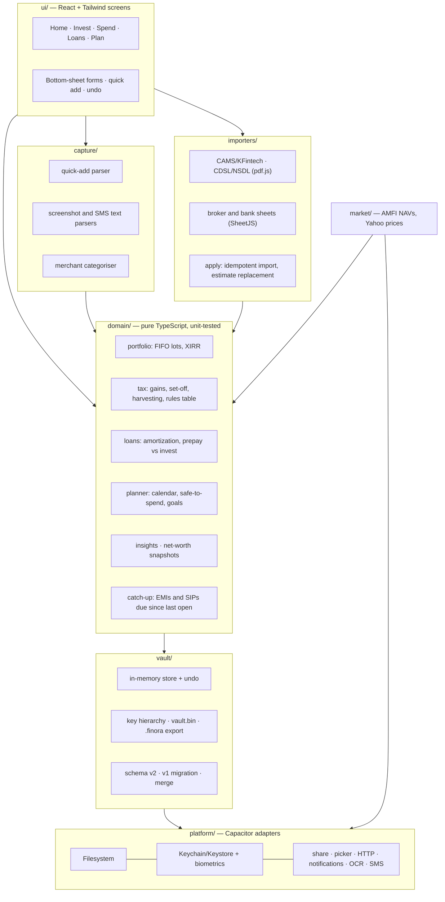
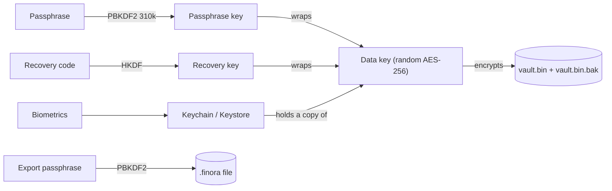

# Finora

A local-first personal finance app for Android and iOS. Investments, SIPs, loans, spending and capital-gains tax in one place, with **no account, no server and no database**. Everything is encrypted on the phone; devices sync by exporting and importing an encrypted file.

> The previous web app (Spring Boot API + PostgreSQL + React SPA) has been retired. Its history is in git (`main` before the `mobile-local-first` branch) and [LEARNING.md](LEARNING.md).

---

## What it does

**Portfolio**
- Mutual funds, stocks, ETFs, bonds, gold and FDs, held per family member (self, spouse, parents…) with a combined Family view
- Holdings are built from individual transactions, so returns are exact **XIRR** (per holding and overall) and sales are matched **first-in, first-out**
- NAVs from AMFI's daily file and stock prices from Yahoo Finance, fetched directly by the phone; works offline with the last known prices

**Statement import (parsed on the phone)**
- **CAMS / KFintech** consolidated statement PDF: every folio with full transaction history; recognises SIP installments and creates SIP records
- **CDSL / NSDL** CAS PDF: demat stocks, ETFs, bonds and MFs
- Broker holdings **Excel/CSV** (Zerodha, Groww, Upstox, ICICI Direct, HDFC Sec, Angel One, 5paisa, Kotak…)
- Password-protected PDFs supported; re-importing the same statement never duplicates

**Tax**
- Capital gains for any financial year: equity/debt/other, short vs long term, grandfathering (31 Jan 2018), the 23 Jul 2024 rate change, loss set-off, ₹1.25L 112A exemption, carry-forward
- **Tax-gain harvesting**: which long-term units to sell and buy back to use this year's exemption, walked in FIFO order
- Loss candidates, and **Schedule 112A** CSV export for the ITR

**Loans**
- EMI schedule, balances that move forward on every EMI date by themselves, prepayments (reduce tenure or EMI)
- **Prepay or invest?** simulator with the break-even return

**Spending**
- One-line **quick add** ("200 chai upi yesterday") parsed on the phone
- **Payment screenshot → expense** with on-device text recognition: Apple Vision on iOS (Finora's own Swift plugin), ML Kit on Android
- **Bank SMS capture**: on Android the app reads bank messages (opt-in, reviewed before adding); on iPhone a Shortcuts automation forwards each bank SMS to `finora://capture`, and you confirm it with one tap
- Bank statement Excel/CSV import with duplicate detection
- Categories learned from your own corrections, per merchant

**Planning**
- **Money calendar** of EMIs, SIP debits, bills and income for the next 30/90 days
- **Safe to spend** this month after commitments and a savings target
- **Goals** linked to real holdings and SIPs, inflation-adjusted, with the extra monthly amount needed
- On-device **insights** (spending spikes, missed SIPs, expensive loans, concentration, harvesting window, stale prices, overdue backup)
- Daily net-worth snapshots and chart
- **Family emergency file**: a (password-protected) PDF of every folio, loan, SIP and nominee

**Privacy and UX**
- AES-256-GCM vault; unlock with passphrase, biometrics or a 52-character recovery code
- Auto-lock, screenshot blocking, app-switcher blur, one-tap **hide amounts**
- Undo instead of confirmation dialogs; bottom-sheet forms; dark mode; Indian number formatting

---

## Architecture



### Encryption



Autosave only uses the data key, so saves are instant. Writes are crash-safe (temp file, then rename, keeping the previous copy). Old `.enc` files from the web app open directly and are upgraded.

### Sync

Export a `.finora` file through the share sheet and import it on the other phone. Records are matched by id; the newer edit wins, deletions travel as markers, and automatically generated records (EMIs, SIP installments, snapshots, imported transactions) have deterministic ids so they never double up.

---

## Project layout

```
app/
  src/domain/      money, dates, portfolio, xirr, loans, sips, tax/, planner/, insights, catch-up
  src/vault/       schema, crypto, store, session, migrate, merge
  src/importers/   pdf text, CAS parsers, sheets, apply
  src/capture/     quick add, categoriser, screenshot/SMS parsers
  src/market/      AMFI and Yahoo
  src/reports/     Excel, Schedule 112A, emergency PDF
  src/platform/    Capacitor plugin adapters
  src/ui/          screens and components
  android/         native Android project (includes SmsReaderPlugin.java)
  ios/             native iOS project (includes TextRecognizerPlugin.swift, Swift Package Manager)
  api/             Vercel Functions relaying AMFI/Yahoo prices for the PWA only
```

---

## Development

Prerequisites: Node 22, plus Android Studio (JDK 21) for Android and Xcode 16+ for iOS.

```bash
cd app
npm install
npm run dev          # browser preview at http://localhost:5173 (no biometrics/OCR/SMS; NAV fetch blocked by CORS)
npm test             # 79 unit tests: domain, vault crypto, importers, capture
npm run lint && npm run typecheck
npm run android      # build, sync and open Android Studio
npm run ios          # build, sync and open Xcode
npm run build:pwa    # installable web app in dist-pwa/, deployed on Vercel (see docs/PWA.md)
```

### Before publishing

- **App id**: `app.finora.mobile` in `app/capacitor.config.ts`; change it before the first store upload.
- **SMS**: `READ_SMS` needs Google Play's Permissions Declaration. To ship without SMS capture, remove that line from `AndroidManifest.xml` (the From SMS button then reports that permission is unavailable; hide it in `Spend.tsx` too).
- **Icons and splash**: still the Capacitor defaults.
- **Tax rules** live in `app/src/domain/tax/rules.ts`; append a rule when a Budget changes rates.
- **Backups**: Android OS backup is disabled for the vault. On iOS, the encrypted vault is part of the normal device backup.

---

## Plans

- [Test plan](docs/TESTING.md): device tests, real-statement accuracy, betas, exit criteria
- [PWA plan](docs/PWA.md): free iPhone and desktop version from the same code
- [Release plan](docs/RELEASE.md): costs, timeline, store checklists

---

## License

Personal project.
